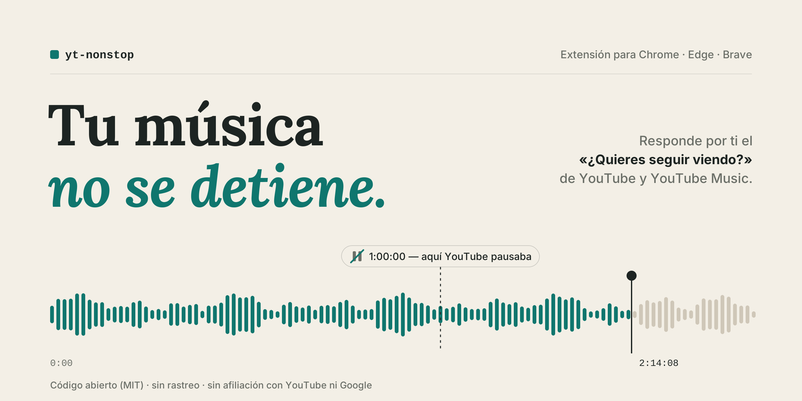

# YT NonStop



Extensión mínima para Chrome/Edge/Brave que evita que YouTube y YouTube Music pausen la reproducción con el aviso **"Video en pausa. ¿Quieres seguir viendo?"**.

- Sin permisos especiales: solo se ejecuta en `www.youtube.com` y `music.youtube.com`.
- Sin conexiones de red, sin rastreo, sin dependencias.
- Un solo archivo de lógica (`content.js`, ~90 líneas) que puedes leer completo antes de instalar.

## Cómo funciona

Usa dos estrategias:

1. **Prevenir:** cada 60 s actualiza la marca interna de "última actividad" de YouTube (`_lact`), para que el aviso no llegue a mostrarse.
2. **Reaccionar:** si el aviso aparece igual, hace clic en confirmar y reanuda el video con `video.play()` (funciona aunque la pestaña esté en segundo plano).

Solo actúa si llevas **5 minutos sin interactuar** con la pestaña de YouTube, así que no interfiere con tus pausas manuales ni con otros diálogos de confirmación.

## Instalación

1. Descarga o clona este repositorio.
2. Abre `chrome://extensions` (o `edge://extensions` / `brave://extensions`).
3. Activa el **Modo de desarrollador**.
4. Haz clic en **Cargar descomprimida** y selecciona la carpeta que contiene `manifest.json`.
   - Si descargaste un zip y Windows creó una carpeta dentro de otra con el mismo nombre, elige la interior.
5. Recarga las pestañas de YouTube que tengas abiertas.

Requiere Chrome 111 o superior (usa `"world": "MAIN"` en el manifest).

## Verificar que funciona

Abre YouTube, presiona `F12` → **Consola**. Deberías ver:

```
[yt-nonstop] activo en www.youtube.com
```

Cuando responda al aviso verás `[yt-nonstop] aviso de inactividad respondido (...)`. YouTube muestra el aviso tras ~60 min de reproducción sin interacción en la web, así que la prueba real requiere dejar algo sonando más de una hora.

## Si deja de funcionar

YouTube cambia su HTML de vez en cuando. Si el aviso vuelve a pausar el video:

1. Cuando aparezca el aviso, clic derecho sobre él → **Inspeccionar**.
2. Anota el nombre del elemento del diálogo y del botón de confirmar.
3. Actualiza `DIALOG_SELECTORS` y `CONFIRM_SELECTORS` al inicio de `content.js`.
4. En `chrome://extensions`, pulsa el ícono de recargar de la extensión.

## Ajustes

Constantes al inicio de `content.js`:

| Constante | Valor por defecto | Qué hace |
|---|---|---|
| `LACT_REFRESH_MS` | 60 s | Frecuencia con la que se refresca la marca de actividad |
| `POLL_MS` | 5 s | Revisión periódica de respaldo del diálogo |
| `MIN_IDLE_MS` | 5 min | Tiempo sin interacción antes de actuar |

## Aviso

Proyecto independiente, no afiliado ni respaldado por YouTube ni Google. YouTube es una marca registrada de Google LLC.

## Licencia

[MIT](LICENSE)
